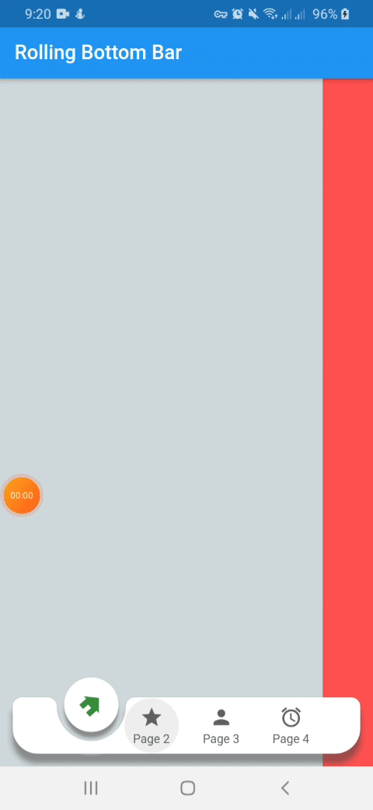

# Rolling Bottom Bar

This packages, based on this [demo](https://codepen.io/kaboc/pen/eYJbbop) by [Kabo](https://codepen.io/kaboc) showing a bottom bar with a dynamic ball indicator.


### New Features 💥 (1.0.0)
* `activeIndex` to control the bar without a `PageController` (the ball animates by itself)
* `topRadius` and `bottomRadius` to customize the bar corners
* `elevation` to customize the shadow
* `itemSize` (`RollingItemSize.sm`, `.md`, `.lg`) to change the ball and items size
* Requires Dart 3 / Flutter 3.10 or higher
## Demo



## Instalation
Include `rolling_bottom_bar` in your `pubspec.yaml` file:

```yaml
dependencies:
  flutter:
    sdk: flutter
  rolling_bottom_bar: ^1.0.0
```

## Usage

To use this package, just import it into your file and build your bottom bar. You can drive it with a `PageController` (the ball follows the swipe of a `PageView`) or with an `activeIndex`.

### With a PageController

```dart
import 'package:rolling_bottom_bar/rolling_bottom_bar.dart';
import 'package:rolling_bottom_bar/rolling_bottom_bar_item.dart';

...

@override
  Widget build(BuildContext context) {
    return Scaffold(
      appBar: AppBar(
        title: Text('Rolling Bottom Bar'),
      ),
      body: PageView(
        controller: _controller,
        children: <Widget>[
          ColoredBox(color: Colors.blueGrey.shade100),
          ColoredBox(color: Colors.redAccent),
          ColoredBox(color: Colors.greenAccent),
          ColoredBox(color: Colors.yellowAccent),
        ],
      ),
      extendBody: true,
      bottomNavigationBar: RollingBottomBar(
        controller: _controller,
        items: [
          RollingBottomBarItem(Icons.home, label: 'Page 1'),
          RollingBottomBarItem(Icons.star, label: 'Page 2'),
          RollingBottomBarItem(Icons.person, label: 'Page 3'),
          RollingBottomBarItem(Icons.access_alarm, label: 'Page 4'),
        ],
        activeItemColor: Colors.green.shade700,
        enableIconRotation: true,
        onTap: (index) {
          _controller.animateToPage(
            index,
            duration: const Duration(milliseconds: 400),
            curve: Curves.easeOut,
          );
        },
      ),
    );
  }
}

...
```

### With an active index

```dart
int _index = 0;

...

bottomNavigationBar: RollingBottomBar(
  activeIndex: _index,
  itemSize: RollingItemSize.md,
  topRadius: 12,
  bottomRadius: 20,
  elevation: 8,
  items: const [
    RollingBottomBarItem(Icons.home, label: 'Page 1'),
    RollingBottomBarItem(Icons.star, label: 'Page 2'),
    RollingBottomBarItem(Icons.person, label: 'Page 3'),
  ],
  onTap: (index) => setState(() => _index = index),
),
```

## Options for Rolling Bottom Bar Item use

|  Name | Description   | Required   | Default   |
| ------------ | ------------ | ------------ | ------------ |
| iconData  | IconData to use as item icon | True   | |
| label  | String to use as label item |  False  | |
| activeColor  | Color to use when icon is active. Only works with useActiveColorByDefault property of RollingBottomBar set on false |  False  | Colors.green|

## Options for Rolling Bottom Bar use

|  Name | Description   | Required   | Default   |
| ------------ | ------------ | ------------ | ------------ |
| controller  | PageView controller to use to move between pages. If set, `activeIndex` is ignored | False   |   |
| activeIndex  | Index of the active item, used when `controller` is null | False   | 0  |
| items  | List of RollingBottomBarItem to render into bottom bar |  True  |   |
| onTap  | Function triggered when an item is tapped | True   |   |
| color  | Color value to use as background | False   |  Colors.white |
| itemColor  | Color value to use with inactive items | False   |  Colors.grey[700] |
| activeItemColor  | Color value to use with active items | False   |  Colors.green  |
| enableIconRotation  | Boolean value to indicate when rotation effect is triggered | False   | false  |
| flat  | Boolean value to indicate if the bottom bar has shadow or not | False   | false  |
| useActiveColorByDefault  | Boolean value to indicate when to use individual active color for each child | False   | true  |
| topRadius  | Radius for the top corners of the bar | False   | 10.0  |
| bottomRadius  | Radius for the bottom corners of the bar | False   | 28.0  |
| elevation  | Elevation of the bar shadow. Ignored when `flat` is true | False   | 5.0  |
| itemSize  | Size of the ball and items: `RollingItemSize.sm` (22), `.md` (26) or `.lg` (30) | False   | RollingItemSize.lg  |

